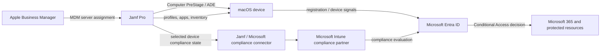

# Integration architecture and terminology

## Two tracks, separate decisions

### Track A: MDM authority migration

Intune currently sends macOS management profiles and apps; Jamf Pro will become the device's management service. Plan old-management retirement and new Jamf enrollment as distinct control-plane steps. Changing a device's ABM MDM server assignment affects a future activation/setup enrollment flow; it does not silently replace an active enrollment. Follow the organization's approved re-enrollment process for each enrollment type.

### Track B: Jamf-managed Mac compliance integration

Jamf Pro continues to own Mac MDM. Jamf reports a selected compliance state into the Microsoft ecosystem so Microsoft Entra Conditional Access can evaluate access. Intune/Entra are not thereby the Mac's MDM authority. A clean control matrix states which product owns enrollment, configuration, apps, compliance calculation, and access decisions.

## Data/control flow

The exact connector flow depends on the configured integration type and current product releases. Use the vendor-maintained Cloud Connector path where supported and recommended; do not copy a legacy manual or Conditional Access recipe without checking its current status.

## Ownership matrix

| Capability | During migration | Target after MDM cutover | Evidence |
|---|---|---|---|
| Apple device ownership and assignment | ABM | ABM | Correct MDM server assignment and asset owner |
| macOS MDM enrollment | Intune for source cohort | Jamf Pro | Jamf enrollment record and expected enrollment method |
| macOS configuration and apps | Intune | Jamf Pro | Reviewed profile/app mapping and device-side validation |
| Compliance calculation for Jamf-managed Macs | Existing design | Jamf Pro criteria reported through supported integration | Jamf compliance group, connector status, Entra device state |
| Access decision | Entra Conditional Access | Entra Conditional Access | Sign-in logs and tested access outcomes |
| Exceptions and support | Named migration lead | Named service owner | Ticket, expiry/review date, escalation route |

## Source references

- [Jamf: Configure Microsoft Entra integration with Jamf Pro](https://learn.jamf.com/r/en-US/technical-paper-microsoft-intune-current/Configuring_the_Microsoft_Intune_Integration)
- [Microsoft: Integrate Jamf Pro with Intune to report compliance to Entra ID](https://learn.microsoft.com/en-us/intune/device-security/compliance/jamf-entra-id)
- [Microsoft: Jamf Pro Cloud Connector](https://learn.microsoft.com/en-us/intune/intune-service/protect/conditional-access-jamf-cloud-connector)
- [Apple: Automated Device Enrollment](https://support.apple.com/guide/security/automated-device-enrollment-secc2cd563ef/web)
